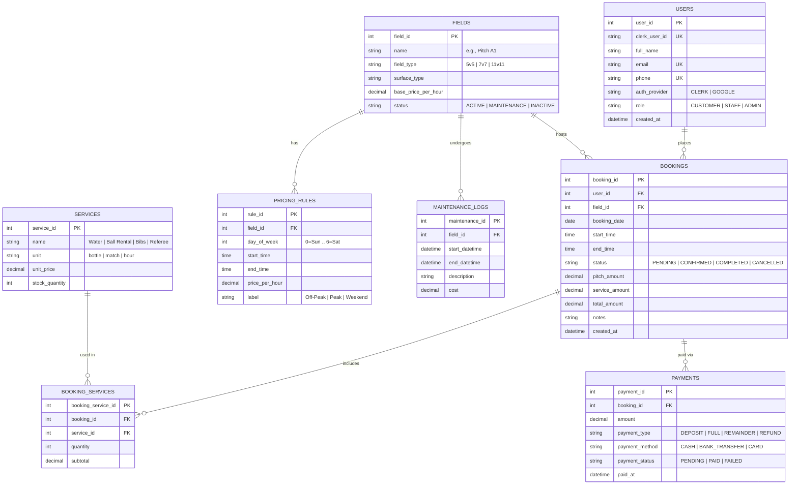
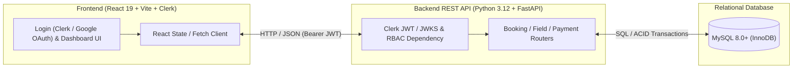

# Project Specification: Football Field Booking and Management System (`BK-88 Stadium`)

## 1. Project Overview

### 1.1 Project Description
The **Football Field Booking and Management System** (branded in the UI as **BK-88 Stadium**) is a full-stack web application developed as a Database Lab final project. It streamlines the reservation, scheduling, billing, and administration of football pitches (5-a-side, 7-a-side, and 11-a-side fields).

Customers can browse pitch availability in real time, book time slots, order add-on matchday services (equipment rental, refreshments, refereeing), and manage their reservations. Venue administrators and staff can manage pitches, configure dynamic time-slot pricing (peak vs. off-peak), process check-ins and payments, and view occupancy and revenue reports.

### 1.2 Objectives
- **Eliminate Double Bookings:** Enforce strict schedule integrity at the database level so overlapping time slots on the same pitch cannot be double-booked.
- **Centralize Matchday Operations:** Provide a unified command centre for customers, staff, and stadium managers.
- **Demonstrate Relational Database Design:** Apply core database engineering concepts including normalization (3NF/BCNF), transactional integrity (ACID), indexing, views, triggers/constraints, and analytical SQL queries.

---

## 2. Current Implementation Status

The repository is structured as a monorepo with `frontend/` and `backend/` directories:

| Layer | Current State | Key Files |
| :--- | :--- | :--- |
| **Frontend (`frontend/`)** | **Initialized & Partially Implemented** — React 19 + TypeScript + Tailwind CSS v4 app with authentication state toggle, Stadium-themed Login view, and initial Dashboard shell. | [App.tsx](file:///d:/ICT-K69/20261%20semester/Database%20lab/Final%20project/DB-Lab/frontend/src/App.tsx), [Login.tsx](file:///d:/ICT-K69/20261%20semester/Database%20lab/Final%20project/DB-Lab/frontend/src/Login.tsx), [Dashboard.tsx](file:///d:/ICT-K69/20261%20semester/Database%20lab/Final%20project/DB-Lab/frontend/src/Dashboard.tsx), [index.css](file:///d:/ICT-K69/20261%20semester/Database%20lab/Final%20project/DB-Lab/frontend/src/index.css) |
| **Backend (`backend/`)** | **Directory Created (Pending Implementation)** — Ready for REST API server and database integration. | `backend/` |

---

## 3. Target User Roles & Functional Requirements

### 3.1 User Roles
1. **Customer (Player / Team Captain):** Registers an account, searches available pitches by date/time/type, creates and cancels bookings, adds extra services, and views booking/payment history.
2. **Staff (Receptionist / Field Coordinator):** Views daily match schedules, checks in teams on arrival, records on-site walk-in bookings, adds post-match consumables/rentals, and processes payments.
3. **Administrator (Stadium Owner / Manager):** Manages pitch inventory, maintenance windows, pricing tiers, staff accounts, promotions, and financial/occupancy analytics.

### 3.2 Core Functional Modules

#### A. Authentication & User Management
- Authentication via **Clerk** (supporting **Google OAuth** social sign-in as well as email/password) plus a local user synchronization table (`USERS` keyed by `clerk_user_id`).
- Role-based access control (`CUSTOMER`, `STAFF`, `ADMIN`) verified via Clerk JWT tokens (`Authorization: Bearer <token>`) and database role lookup.
- Profile management (contact phone number, team name, booking history).

#### B. Pitch & Pricing Management
- CRUD operations for football fields (`5v5`, `7v7`, `11v11`), surface type (artificial turf, natural grass), floodlight availability, and status (`ACTIVE`, `MAINTENANCE`, `INACTIVE`).
- Dynamic time-slot pricing rules based on day of week (weekday vs. weekend) and time of day (off-peak vs. peak evening hours).

#### C. Real-Time Booking & Scheduling Engine
- Interactive timetable showing free, reserved, and maintenance slots per pitch and date.
- Single-match and recurring (weekly) booking creation.
- Automatic price calculation combining base slot rate + duration + add-on services.
- Concurrency-safe booking validation (preventing overlapping reservations for the same pitch).
- Booking lifecycle transitions: `PENDING` → `CONFIRMED` → `COMPLETED` (or `CANCELLED` / `NO_SHOW`).

#### D. Add-On Services & Inventory
- Extra matchday items/services: ball rental, bibs/vests, bottled water, energy drinks, referee booking, lighting surcharge.
- Line-item attachment to any active booking with automatic invoice recalculation.

#### E. Billing, Deposits & Payments
- Support for deposit payment (e.g., 30% upfront) and full settlement upon check-out.
- Multiple payment methods (`CASH`, `BANK_TRANSFER`, `E_WALLET`, `CARD`).
- Automated invoice and receipt generation.

#### F. Analytics & Reporting (Database Lab Focus)
- Daily/monthly revenue breakdown by pitch and field type.
- Peak-hour utilization rate and occupancy heatmaps.
- Top customers and cancellation/no-show statistics.

---

## 4. Relational Database Schema Specification

> [!IMPORTANT]
> **Key Database Integrity Constraints & Features for DB Lab (MySQL 8.0+)**
> - **Overlap Prevention:** `BEFORE INSERT` and `BEFORE UPDATE` MySQL triggers on `BOOKINGS` (using `SIGNAL SQLSTATE '45000'`) ensuring no two `CONFIRMED`/`PENDING` bookings on the same `field_id` and `booking_date` have overlapping `[start_time, end_time)` intervals, paired with `SELECT ... FOR UPDATE` row locking in transactions.
> - **Check Constraints:** `CHECK (end_time > start_time)`, `CHECK (total_amount >= 0)`, `CHECK (quantity > 0)`.
> - **Transactions:** Atomic booking creation + deposit recording + service stock deduction in InnoDB.

---

## 5. System Architecture & REST API Design

### Core REST API Endpoints (Target)
| Method | Endpoint | Description | Access |
| :--- | :--- | :--- | :--- |
| `POST` | `/api/auth/sync` | Sync authenticated Clerk / Google OAuth user into MySQL `USERS` | Authenticated |
| `GET` | `/api/auth/me` | Get current user profile and DB role (`CUSTOMER`/`STAFF`/`ADMIN`) | Authenticated |
| `GET` | `/api/fields` | List all pitches with filtering by type/status | Public |
| `GET` | `/api/fields/{id}/availability` | Get time-slot availability for a specific date | Public |
| `POST` | `/api/bookings` | Create a new field reservation (transactional) | Customer / Staff |
| `GET` | `/api/bookings` | List current user's bookings (or all for Staff/Admin) | Authenticated |
| `PATCH` | `/api/bookings/{id}/status` | Confirm, check-in, complete, or cancel a booking | Staff / Admin |
| `POST` | `/api/bookings/{id}/services` | Add matchday services/rentals to a booking | Customer / Staff |
| `POST` | `/api/payments` | Record deposit or settlement payment | Customer / Staff |
| `GET` | `/api/reports/revenue` | Aggregate revenue & utilization analytics | Admin |

---

## 6. Technology Stack

### 6.1 Frontend (Implemented in [frontend/package.json](file:///d:/ICT-K69/20261%20semester/Database%20lab/Final%20project/DB-Lab/frontend/package.json))
- **Core Framework:** React `^19.2.8` with React DOM `^19.2.8`
- **Authentication:** `@clerk/clerk-react` (Clerk authentication with Google OAuth social login)
- **Language:** TypeScript `~6.0.2` (strict type checking via `tsc -b`)
- **Build Tool & Dev Server:** Vite `^8.3.0` (`@vitejs/plugin-react` `^6.1.1`)
- **Styling:** Tailwind CSS `^4.3.3` with `@tailwindcss/vite` `^4.3.3`
  - Includes dark/light mode support (`color-scheme: light dark`) and custom stadium turf CSS utilities (`pitch-bg` in [index.css](file:///d:/ICT-K69/20261%20semester/Database%20lab/Final%20project/DB-Lab/frontend/src/index.css)).
- **Code Quality & Linting:** ESLint `^10.10.0`, `typescript-eslint` `^8.69.0`, `eslint-plugin-react-hooks`, and `eslint-plugin-react-refresh`.

### 6.2 Backend & Database (`backend/`)
- **Language & Runtime:** Python `3.12`
- **Web Framework:** FastAPI + Uvicorn + Pydantic v2
- **Database Driver / SQL Layer:** `PyMySQL` + SQLAlchemy 2.0 Core/Engine (executing explicit parameterized SQL & ACID transactions for Database Lab requirements)
- **Authentication Verification:** `PyJWT` + `cryptography` (verifying Clerk RS256 session JWTs via Clerk JWKS endpoint)
- **Relational Database:** **MySQL 8.0+ (InnoDB)**

---

## 7. Non-Functional Requirements
- **Responsive Design:** Mobile-first layout supporting both phones (players booking on the go) and desktop screens (stadium command centre).
- **Theme Support:** Automatic and manual Light/Dark mode compatibility (already established in [Login.tsx](file:///d:/ICT-K69/20261%20semester/Database%20lab/Final%20project/DB-Lab/frontend/src/pages/Login.tsx) and [Dashboard.tsx](file:///d:/ICT-K69/20261%20semester/Database%20lab/Final%20project/DB-Lab/frontend/src/pages/Dashboard.tsx)).
- **Data Integrity & Concurrency:** MySQL InnoDB ACID transactions + `BEFORE INSERT`/`BEFORE UPDATE` overlap triggers preventing race conditions when two users attempt to book the same pitch slot simultaneously.
- **Security:** Clerk + Google OAuth RS256 JWT validation, parameterized SQL queries to prevent SQL injection, and RBAC route dependencies.
